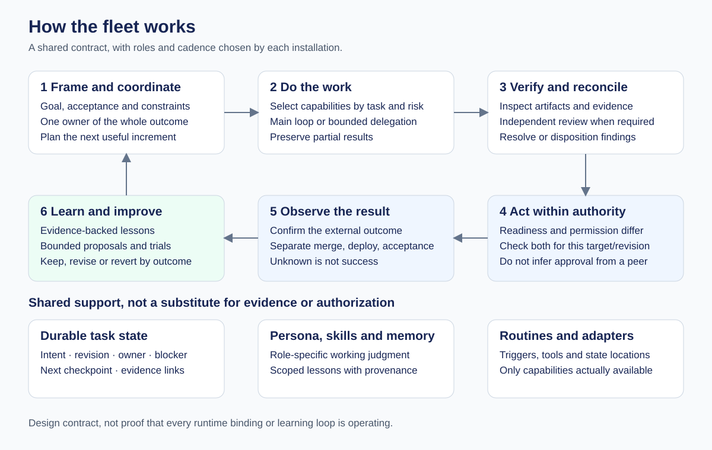

# Skills

[](https://skills.sh/mitchellknoth/skills)

Reusable workflows for coding agents. Each skill is a portable `SKILL.md` with its supporting files, organized by category.

## Skills

- [fleet-architecture](skills/engineering/fleet-architecture/SKILL.md) — a configurable template for agent delivery roles, handoffs, readiness, state and feedback.
- [fleet-preset](skills/engineering/fleet-preset/SKILL.md) — the author's opinionated delivery flow, explicitly selected and independently installable.
- [implement-review-loop](skills/engineering/implement-review-loop/SKILL.md) — implement substantial milestones with test-first cycles and independent review.

The fleet MVP is **Grok Bot first**, with a manual [deployment blueprint](skills/engineering/fleet-preset/references/grok-mvp.md). Cross-harness transpilation is a [capability-aware roadmap](skills/engineering/fleet-architecture/references/transpilation.md), not a shipped runtime compiler.

See the [fleet quickstart](docs/fleet-quickstart.md) for examples, mode selection, local validation and runtime limits. This first fleet package is an **initial draft**, not an export of an active bot account.

See the [persona catalog](skills/engineering/fleet-preset/references/PERSONAS.md) for explicit coverage limits and the [candidate skill assessment](docs/skill-candidate-assessment.md) for proposed evolution experiments. These are not complete per-bot memory or performance grades.

## Visual guide

[Explore the illustrated fleet guide](docs/fleet-visual-guide.md): architecture and handoffs, learning versus measured evolution, and the preset versus build-your-own paths. The diagrams describe intended design, not proven live effectiveness.



## Install

Choose one installation method per agent to avoid duplicate skills.

### Vercel Skills

Install in the current project, choosing your agent interactively:

```sh
npx skills@latest add mitchellknoth/skills
```

To install one skill for a specific agent, add `--skill implement-review-loop --agent codex` (or select `fleet-architecture` or `fleet-preset`); add `--global` for a user-wide installation. Run `npx skills@latest check` to check for updates and `npx skills@latest update` to update installed skills. Re-run `add` to discover and install newly added skills.

### Codex plugin

```sh
codex plugin marketplace add mitchellknoth/skills
codex plugin add knoth-skills@knoth
```

Use `codex plugin marketplace upgrade knoth` to refresh the marketplace. Plugin updates depend on the client and its configuration.

### Claude Code plugin

```sh
claude plugin marketplace add mitchellknoth/skills
claude plugin install knoth-skills@knoth
```

Manage marketplace auto-updates in Claude Code, or run `claude plugin marketplace update knoth` to refresh it.

### Cursor

For individual use, install through Vercel Skills with `--agent cursor`. Teams can import this repository as a team marketplace in Cursor's **Dashboard → Plugins & MCPs**, then install `knoth-skills` from Customize. GitHub imports can enable Auto Refresh; this requires the Cursor GitHub App on the repository. See [Cursor's plugin documentation](https://cursor.com/docs/plugins) for plan requirements and update behavior.

## Invoke

Ask your agent to use `implement-review-loop` for an issue or feature. The implementer works through test-first cycles within a substantial milestone, then an independent reviewer evaluates the milestone before the next one begins.

## Validate the fleet package

```sh
python3 -m unittest discover -s tests -v
python3 scripts/sync-fleet-core.py --check
```

These test packaging and an inert readiness model, not live agent reliability. See [design and limits](docs/fleet-design.md).

## Contributing skills

Place each skill in `skills/<category>/<skill-name>/SKILL.md`. List each distributed skill directory in both plugin manifests, and bump both plugin versions together when publishing changes. All distribution methods point to these source directories. Shared fleet support is canonical in `fleet-architecture` and generated into `fleet-preset` for standalone installation; synchronize it with `python3 scripts/sync-fleet-core.py` rather than editing copies.

## License

[MIT](LICENSE)
