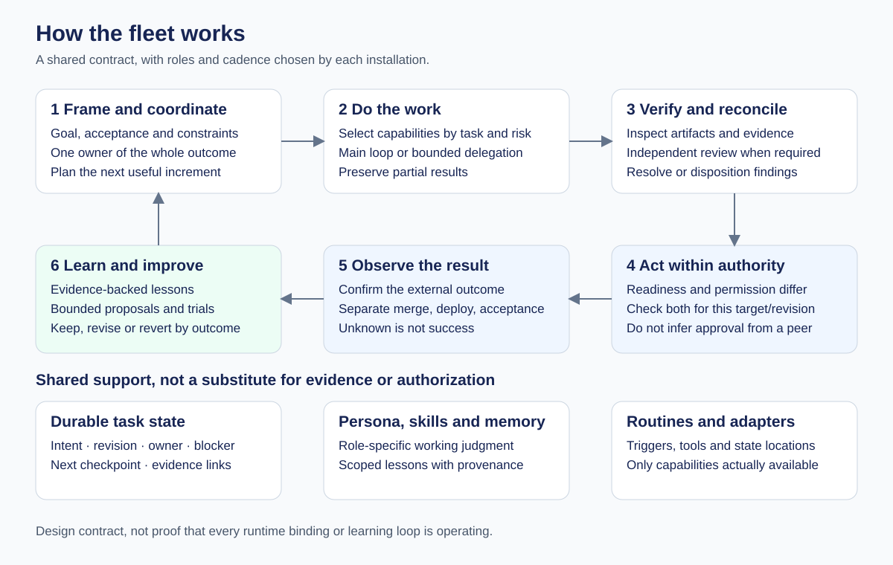
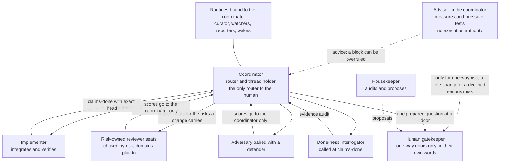
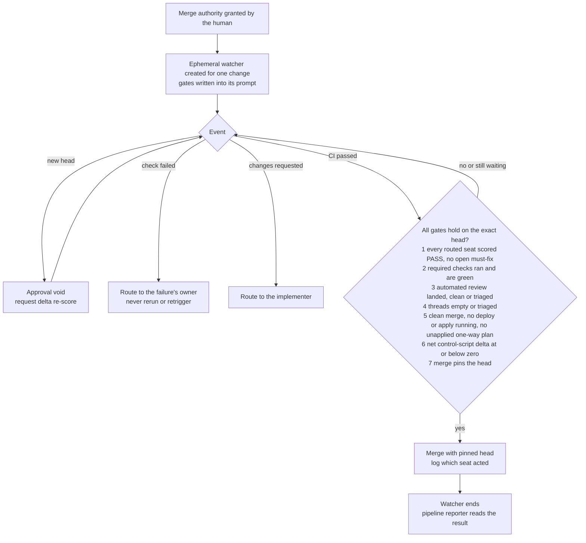
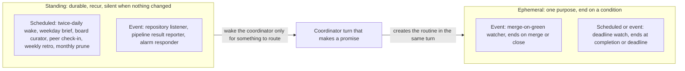
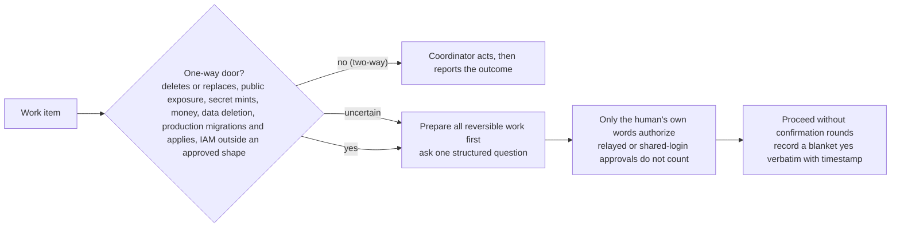
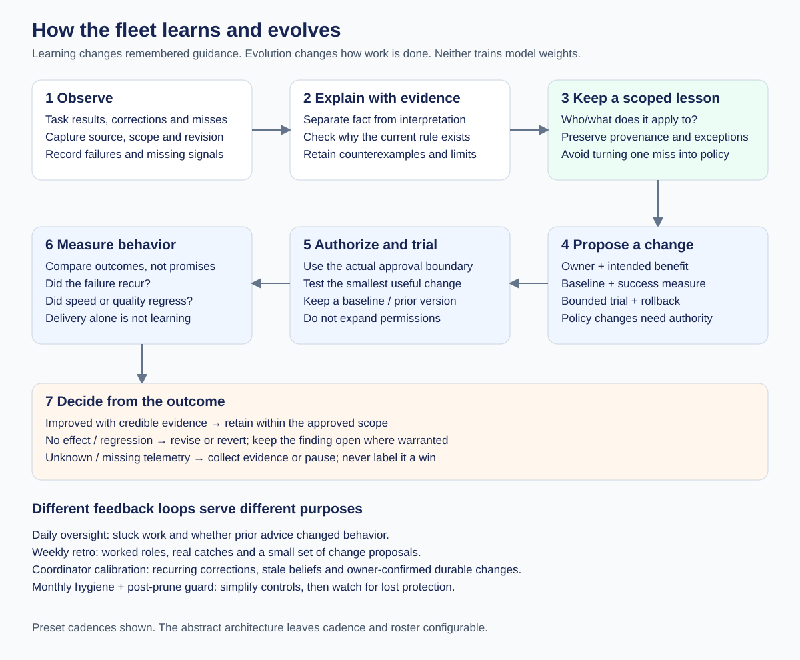
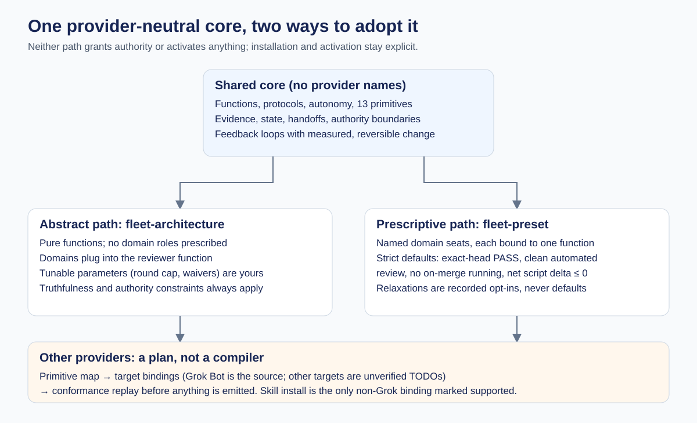

# Fleet visual guide

These diagrams explain the design. They do not certify that a runtime has implemented it or that improvements have been proven in live use. The three SVGs are the generic lifecycle, learning and adoption views; the Mermaid diagrams after them show roles, the merge gate, routines and where the human is asked. Each depicts only what the protocols describe, and the review panel has no fixed seat order: seats are chosen by risk and score the same exact head independently.

## How the pieces work together

The coordinator owns the outcome. Skills and delegated roles supply capabilities; they do not transfer that ownership. Readiness and permission are separate checks. Durable state keeps evidence and next actions visible across handoffs.

[Read the architecture contract](../skills/engineering/fleet-architecture/references/architecture.md).

## Who advises whom, and who decides

Specialists answer the coordinator, not the room and not the human. The advisor sits beside the coordinator: it cannot merge, apply, change product code or wake agents without a finding. A function may share an agent with another unless a protocol requires independence.

## The merge gate

The watcher automates the checks; it does not create authority. A human waiver is recorded in their words and never covers the exact-head reviewer scores or an unapplied one-way-door plan. When all agents merge under one shared platform login (the low-friction default), the platform cannot tell them apart, so the ledger records the acting seat. The recommended target is a distinct least-privilege identity per agent.

## Routines: standing and ephemeral

## Where the human is asked

Status, scores, reviews, drafts, dry plans, opening and fixing changes, merges within granted authority and starting the next increment never interrupt the human.

## Learning and evolution

**Learning** retains a scoped, evidence-backed lesson. **Evolution** changes a skill, routine or operating rule and checks whether behavior improves. A written retro is neither proof of learning nor proof of benefit. An inconclusive result is different from a measured lack of benefit.

The Grok Bot preset uses distinct loops rather than one generic retrospective: daily oversight, weekly fleet retro, coordinator calibration, monthly hygiene and a post-prune watch. They serve different purposes and should not silently replace each other.

[Read the evolution contract](../skills/engineering/fleet-architecture/references/evolution.md) · [Read the preset retrospective routines](../skills/engineering/fleet-preset/references/retrospectives.md).

## Preset or build-your-own

The abstract path (`fleet-architecture`) defines functions, protocols, an autonomy layer and thirteen provider-neutral primitives, and leaves domains and tunable values to the installation. The prescriptive path (`fleet-preset`) binds named domain seats to those functions and defaults to the strict rules: exact-head reviewer PASS, an automated review that is clean or triaged, no deploy or apply running, and a net control-script delta at or below zero. Relaxations are recorded opt-ins. Translation to other runtimes is a plan from the primitive map; apart from skill install, non-Grok bindings are unverified and it is not an implemented compiler today.

## Editable assets

The SVG files and the Mermaid blocks in this file are the source. The SVGs include titles and descriptions for accessibility and need no renderer; Mermaid renders on the code host.
