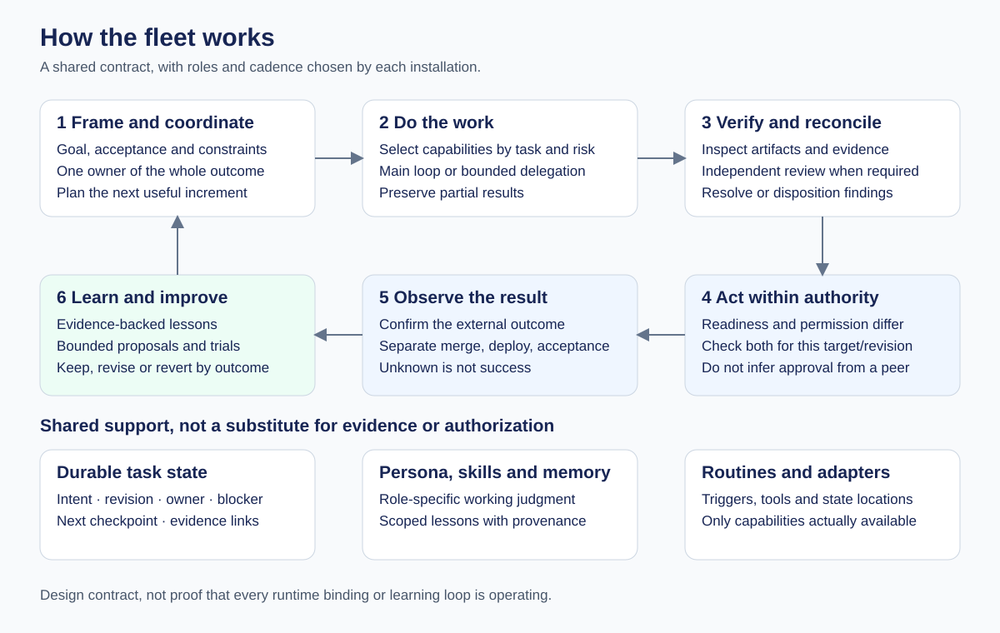
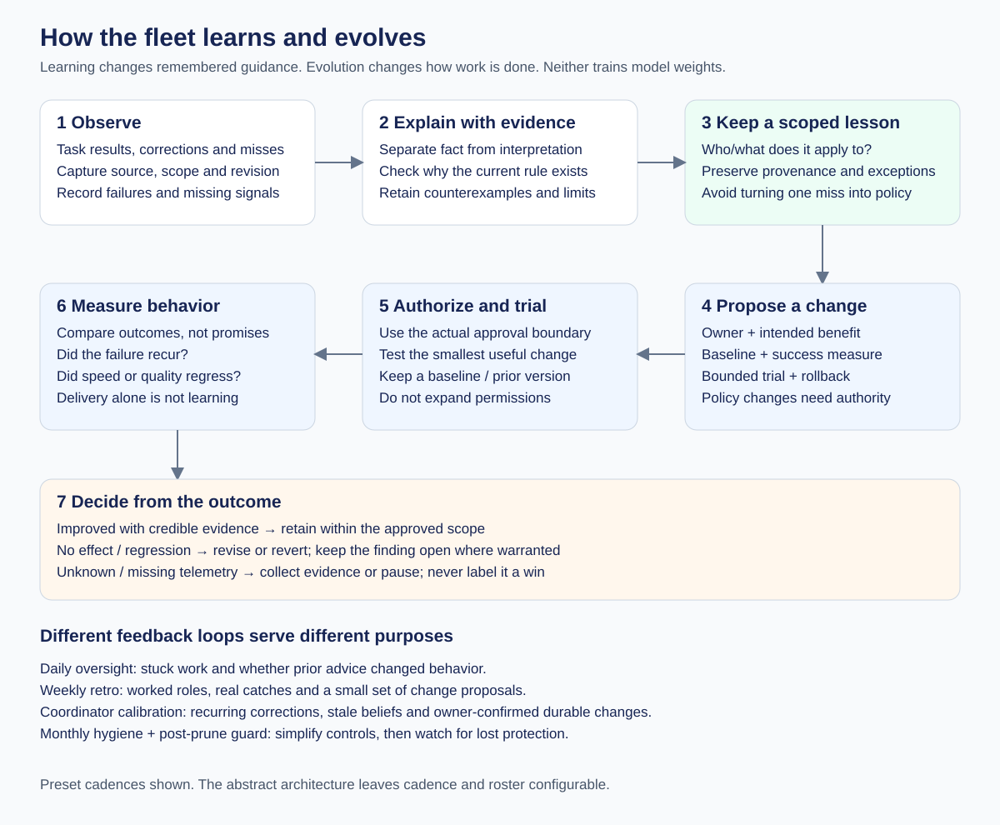
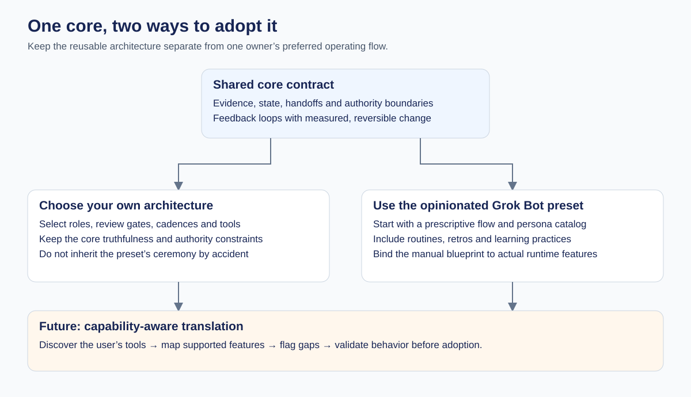

# Fleet visual guide

These diagrams explain the design. They do not certify that a runtime has implemented it or that improvements have been proven in live use.

## How the pieces work together

The coordinator owns the outcome. Skills and delegated roles supply capabilities; they do not transfer that ownership. Readiness and permission are separate checks. Durable state keeps evidence and next actions visible across handoffs.

[Read the architecture contract](../skills/engineering/fleet-architecture/references/architecture.md).

## Learning and evolution

**Learning** retains a scoped, evidence-backed lesson. **Evolution** changes a skill, routine or operating rule and checks whether behavior improves. A written retro is neither proof of learning nor proof of benefit. An inconclusive result is different from a measured lack of benefit.

The Grok Bot preset uses distinct loops rather than one generic retrospective: daily oversight, weekly fleet retro, coordinator calibration, monthly hygiene and a post-prune watch. They serve different purposes and should not silently replace each other.

[Read the evolution contract](../skills/engineering/fleet-architecture/references/evolution.md) · [Read the preset retrospective routines](../skills/engineering/fleet-preset/references/retrospectives.md).

## Preset or build-your-own

The abstract architecture leaves roles, cadence and workflow choices open. The preset supplies concrete defaults. Future translation to other runtimes must report capability gaps and validate behavior; it is not an implemented compiler today.

## Editable assets

The SVG files are the source. They include titles and descriptions for accessibility and require no diagram renderer or external service.
